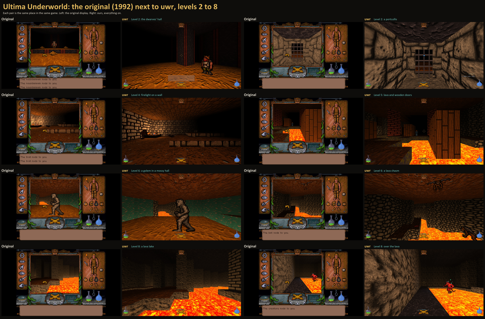

# uwr: Ultima Underworld Rekonfigmasturfication

Ultima Underworld: The Stygian Abyss (1992) running on Windows and Linux with a renderer, sound and interface of our
own, in plain C (clang). The game's rules are meant to be EXACTLY those of the original UW.EXE; only the presentation
(graphics, sound, interface, controls) and a few optional extras may differ, and each of those has a switch in the
Esc menu. The program is `uwr` (`uwr.exe` on Windows), short for Ultima Underworld Rekonfigmasturfication.

This repository holds only what we made ourselves: no original game files, no executables, no ROMs and no
third-party sources. You need your own copy of the game to run anything. It is a snapshot of our working tree,
taken by `tools/uwr_export.py`.

## Built on others' work

This port would not exist without two projects, both under the MIT licence:

- **Underworld Exhumed** by abedegno (https://github.com/abedegno/underworld-exhumed): a byte-matching rebuild of
  UW.EXE in C. We borrowed from it heavily. Its code is the rules core the game runs on (compiled here unchanged,
  with our own glue files beside it), and some of our own rule code is adapted from it, each routine naming its
  source file and line. Its files are not in this repository.
- **Ultima Underworld Editor** by Karl Clinckspoor (https://github.com/KarlClinckspoor/UltimaUnderworldEditorAvalonia):
  a level editor. We built a test tool on its core library, `uwcheck`, which starts our game hidden, visits every
  level, saves, and runs the editor's own checks on the saved levels. It is for testing only: nothing of the editor
  is in the game, and the tool lives in a repository of its own.

The full list of what we use, with the licences, is in [THIRD-PARTY-NOTICES.md](THIRD-PARTY-NOTICES.md).

The published work and measurements behind our changes (fire, firelight's colour, water, acoustics, creature AI)
are listed in [SOURCES.md](SOURCES.md).

## What it looks like

The same places in the same game: the original 1992 display on the left of each pair, ours on the right with
ray tracing, upscaled textures, relief maps and the effects on. Click a picture for its full size (7824 x 5156).

## Trying it

- **There is no download yet.** This repository is the source only; a ready-to-run package for Windows and Linux
  is being prepared (`tools/makepublic.py`). It will hold our programs only: nothing from the game.
- **You need your own copy of Ultima Underworld: The Stygian Abyss.** The game reads its data files from it. The
  Roland MT-32 sound also needs your own ROM files.
- **Building it yourself** needs LLVM clang, the Underworld Exhumed source and its Exhume tools. The build scripts
  still carry the folder paths of our own machine and have to be edited first. [port/README.md](port/README.md)
  describes the Windows build, [docs/LINUX_BUILD.md](docs/LINUX_BUILD.md) the Linux one.
- The keys are listed in [docs/KEYBINDS.md](docs/KEYBINDS.md).
- Every row of the Esc menu (the options), what it does and how it works: [docs/ESC_MENU.md](docs/ESC_MENU.md).

## What is in it

- **Renderer.** Vulkan, the default on both systems since 2026-11-16; the older Direct3D 12 renderer is still there
  on Windows (the Esc menu's Renderer row). Hardware ray tracing (light, shadows, bounced light), DLSS / DLAA and
  DLSS Ray Reconstruction, HDR output. DLSS 5 exists in the Direct3D 12 renderer only and is not being carried on.
- **Walls and floors.** The game's own textures, or upscaled to 256 / 512 pixels in the same colours; normal maps,
  joint shadows (AO) and relief shadows, with maps made at each texture size.
- **Effects.** Particles, decals, water, firelight with the eye's adaptation.
- **Sound.** The Roland MT-32's own voices, placed in space (OpenAL Soft, headphone 3D); walls and doors muffle,
  rooms ring by their size, sound comes round corners; with Steam Audio: ray-traced echoes through the level's
  shape, occlusion and transmission by each surface's material, pathing (a hidden sound arrives along the ways
  through the level, from the doorway it comes through) and binaural rendering; footsteps by the floor.
- **Interface.** A full-screen 3D view with our own HUD, character sheet, inventory, automap and conversation
  screen, one smooth font, mouse-look and modern keys. The 1992 screen as it was is one menu row away.
- **Creatures.** Three AI levels. The game's numbers (hit points, damage, speed, every roll) are the same at all
  three; only what a creature chooses changes, and it acts only on what it saw, heard or was told by its kin.
  - **Original**: the game as shipped.
  - **Devious**: each creature is cunning on its own. One that loses you goes to where it last knew you were,
    searches, and checks the door you may have left by; one that hears a blow, a door, a lever or a spell, sees
    your light, or hears you run (walking is silent) goes to look; clever ones lie in ambush, hold a doorway and
    let you come, and one that lost you or ran from you lies in wait the next time; shooters and casters hit and
    run and put water or a drop between you. Shot from where it cannot reach you, a creature goes out of your
    sight; one that flees runs for cover, not straight away. Friendly creatures nod, follow you if your weapon
    is drawn, back away, or point out a foe. One or two hunters a level track you across the whole level by a
    plan.
  - **Monstrous**: they also work together. A creature calls or fetches its kin, the call is passed on, the
    called gather and strike together while one goes to the door behind you and the third to a fight goes
    round your back; a clever one shows itself and falls back to lead you in among kin lying in wait; they
    will not be drawn away from one another one at a time; spiders and bats attack as a pack; the wounded run
    to kin and come back with them; shooters keep behind those who fight hand to hand; a death cry rouses the
    kin in earshot, and the roused watch the doors for minutes after; a level hunter brings its pack.

  Every part has its own row in the Esc menu ([docs/ESC_MENU.md](docs/ESC_MENU.md), "AI"). The choices are made by
  a built-in rulebook, or optionally by a small language model run on the player's own machine. Every decision is
  written to the log file with its reason, and each part counts how often it was used.
- **The original's 3D models** (doors, portcullises, bridges, weapons on the floor) decoded from UW.EXE and drawn.

## Where it is going

- One Vulkan renderer for Windows and Linux; new renderer work goes there, Direct3D 12 stays as it is.
- Linux: the target is Linux Mint. The Linux programs are cross-built on Windows
  ([docs/LINUX_BUILD.md](docs/LINUX_BUILD.md)) and have so far only been start-checked under WSL.
- The rules core keeps being checked routine by routine against the original ([ROUTINES.md](ROUTINES.md)).
- Open at the last cut (2026-11-16): the newest sound rows and the Vulkan renderer's Linux side have been built and
  started, not yet played through.

## Where to start

| You want to | Read |
| --- | --- |
| know what each option in the Esc menu does | [docs/ESC_MENU.md](docs/ESC_MENU.md) |
| know the rules every session follows | [CLAUDE.md](CLAUDE.md), [DECOMP_RULESET.md](DECOMP_RULESET.md) |
| see status and next steps | [NOTES.md](NOTES.md), [ROADMAP.md](ROADMAP.md) |
| see which original routines are ported and proved | [ROUTINES.md](ROUTINES.md), [re/README.md](re/README.md) |
| read the decoded game mechanics | [MECHANICS.md](MECHANICS.md) |
| understand the engine source | [src/README-src-a.md](src/README-src-a.md), [src/README-src-b.md](src/README-src-b.md) |
| understand the Windows backend | [port/README.md](port/README.md) |
| build for Linux, and how the renderer got there | [docs/LINUX_BUILD.md](docs/LINUX_BUILD.md), [docs/LINUX_RENDERER.md](docs/LINUX_RENDERER.md) |
| understand our additions to the rules core | [underworld-exhumed-additions.md](underworld-exhumed-additions.md) |
| run or write tests | [tests/README.md](tests/README.md) |
| use the proof, patch and build scripts | [tools/README-tools-a.md](tools/README-tools-a.md), [tools/README-tools-b.md](tools/README-tools-b.md) |
| make normal maps | [tools/laigter-cli/README.md](tools/laigter-cli/README.md) |
| learn about the AI-driven creatures / models | [LLM_NPC_AI.md](LLM_NPC_AI.md), [docs/MODELS.md](docs/MODELS.md) |
| see design plans and specs | [docs/superpowers/](docs/superpowers/) |
| see third-party credits | [THIRD-PARTY-NOTICES.md](THIRD-PARTY-NOTICES.md) |

## How the pieces fit

- **Rules core**: underworld-exhumed's C (a byte-matching rebuild of UW.EXE, MIT) plus our own glue files. Our
  additions to it are listed in [underworld-exhumed-additions.md](underworld-exhumed-additions.md); its own files are
  not in this repository.
- **Our engine** (`src/`): front end, the two renderers (`render_vk*.c` Vulkan, `render.c` Direct3D 12, one set of
  HLSL shaders in `shaders/` for both), audio, inventory, level and world handling.
- **Backends** (`port/`): `win32/` is the Windows platform layer and holds the files both systems share (front
  end, menu, audio, acoustics, input); `sdl3/` is the Linux platform layer over SDL3.
- **Proof** (`tools/proof_*.py`, `tools/emu.py`): each ported routine is run beside the original under an emulator
  on the same inputs; matching routines are listed in `re/proved.txt`.
- **Relief maps** (normal, occlusion and height maps for walls, floors and sprites): not in this repository and
  not in the download. The game makes them on its first start from the player's own game files, with
  `tools/laigter-cli` and its presets (`src/mapsmake.h`); they come out pixel for pixel as the ones we tuned.
- **The download** is put together by `tools/makepublic.py`, which copies only named files and refuses anything
  that looks like a game file, a ROM, a model or a picture.

## Notes and warnings

- The `tools/*_patch.py` scripts were each run once, in 2026-11, to edit the source. They are history; do not re-run
  them (their safety asserts do not always refuse a second run).
- Root `build.cmd`, `run-tests.cmd` and `play.cmd` serve our own C engine (`build/uw.exe`); the exhumed-based port
  is built by `tools/portwin32.py`.
- `src/render.c`, `src/render_vk*.c`, `src/render.h` and `src/shaders/` are not described in a guide yet; the Vulkan
  renderer's plan and ledger are in `docs/superpowers/plans/2026-11-15-vulkan-renderer.md`.

## Known mismatches and open questions

The eight listed here until 2026-11-16 were checked against the source and the original's disassembly, and put right:

- Fixed in the code: the inventory panel's "Carrying" weight now counts the item on the pointer, as the carry limit
  does; `main.c`'s two options that were tested twice have names of their own (`--conv=N`, `--frame-picks=`), so
  the later branches can be reached. `run-tests.cmd`'s chargen line still passes `--picks=` and behaves as before.
- Fixed in the comments (the code was right): only `data/lights.txt` is read (`lights.h`, `main.c`); `Mesh.grid`
  byte 2 is the floor's terrain (`level.h`); creatures are hostile by their attitude bits (`game.c`); `core.py`
  takes no argument; `tools/relief_section.c.txt` is marked as history (relief v4; `src/normals.c` has v7).
- Not mismatches after all: the two songs' addresses in `songs.h` and `songs.c` are both in UW.EXE (a block's start
  and the lines inside it; the header now names both), and `sfx_stop`'s test of slots 0-7 matches the original's
  8-bit mask (four slots are ever set).
- Still as it was: `tools/laigter-cli/pixelart.preset` is not used by `make-normals.cmd`; it is kept as the
  settings `sprite_op.preset` was made from.

The per-area guides list more ("UNSURE" at the end of `src/README-src-a.md` and `src/README-src-b.md`); those have
not been checked yet.

## Licence

Our own code and files are under the MIT licence: [LICENSE](LICENSE). One part differs: `tools/laigter-cli` is a port
of Laigter and is GPL v3 (its own licence file is in that folder). Everything we use from others is listed in
[THIRD-PARTY-NOTICES.md](THIRD-PARTY-NOTICES.md).

Ultima Underworld is the property of its owners (Electronic Arts). This project is not affiliated with or endorsed
by them, and contains none of the game's files.
